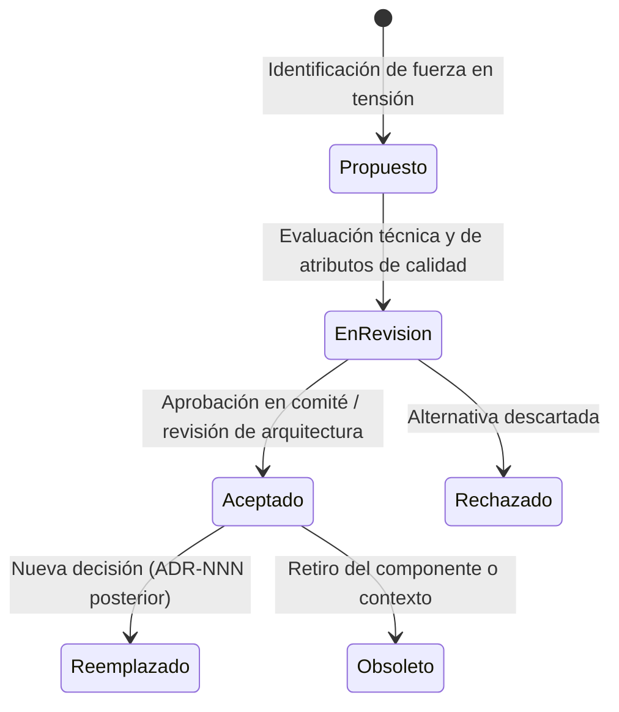

# Registros de Decisiones Arquitectónicas (ADR)

Este directorio contiene los **Registros de Decisiones Arquitectónicas (*Architecture Decision Records* — ADR)** de la **Plataforma Digital de Servicios Consulares y de Legalización** (MRREE – UTEC Posgrado).

Los ADR se redactan siguiendo el formato **MADR (*Markdown Architectural Decision Records*)** en español, utilizando como base la plantilla [template.md](template.md).

---

## 1. Índice de Decisiones Arquitectónicas

| Código | Título | Estado en `main` | Módulo / Sesión | Observaciones |
| --- | --- | --- | --- | --- |
| [ADR-000](ADR-000-version-de-plataforma.md) | Selección de versión de plataforma (Java 21 LTS y Spring Boot 3.4.x) | **Aceptado** | Transversal (`M1`–`M4`) | Justifica la adopción uniforme de Java 21 (Eclipse Temurin), Spring Boot 3.4.3, Spring Cloud 2024.0.0 y Spring Modulith 1.3.3. |
| [ADR-001](ADR-001-estilo-y-consistencia.md) | Estilo arquitectónico inicial de la plataforma y consistencia de las operaciones de citas | **Aceptado (Parte 1)** / **En revisión (Parte 2 — A1)** | `m1-estilos` (S1–S2) | La Parte 1 documenta la elección del Monolito Modular Evolutivo; la Parte 2 es un esqueleto que el participante completa en la [Asignación A1](../asignaciones/A1.md) (versión completa en `solucion/a1`). |
| [ADR-002](ADR-002-saga-orquestada.md) | Coordinación del proceso distribuido Solicitud → Pago → Emisión mediante Saga Orquestada | **Aceptado** | `m3-datos` (S4) | Justifica `SagaSolicitudTramite` en `tramites-service` frente a coreografía pura y 2PC/XA. |
| [ADR-003](ADR-003-outbox-transaccional.md) | Publicación confiable de eventos mediante el patrón Transactional Outbox | **Aceptado** | `m3-datos` (S4) | Resuelve el problema de doble escritura (*Dual Write*) entre PostgreSQL y RabbitMQ mediante tablas `outbox` y `RelayOutbox`. |
| [ADR-004](ADR-004-event-sourcing-tramite.md) | Persistencia del ciclo de vida del agregado `Tramite` mediante Event Sourcing y proyección CQRS | **Aceptado** | `m3-datos` (S4–S5) | Justifica la bitácora inmutable `tramites.eventos_tramite` combinada con el modelo de lectura `tramites.vista_tramite`. |
| [ADR-005](ADR-005-opentelemetry.md) | Instrumentación de observabilidad unificada con OpenTelemetry Java Agent y pila Grafana LGTM | **Aceptado** | `m4-observabilidad` (S5–S6) | Justifica la telemetría *zero-code* con `opentelemetry-javaagent.jar`, propagación W3C `traceparent` y correlación Logs–Métricas–Trazas. |
| [ADR-006](ADR-006-cache-consulta-tramite.md) | Estrategia de caché de lectura para la consulta de estado de trámites (`GET /api/tramites/{id}`) | **En revisión (A4)** | `m3-datos` / `m4-observabilidad` (S5) | Esqueleto que el participante completa en la [Asignación A4](../asignaciones/A4.md) (versión completa en `solucion/a4`). |

---

## 2. Ciclo de Vida de un ADR

Un ADR captura una decisión arquitectónica significativa junto con su contexto, las alternativas evaluadas y las consecuencias aceptadas (*trade-offs*). Su ciclo de vida atraviesa los siguientes estados:

1. **Propuesto / En revisión:** El arquitecto o equipo documenta el contexto, los escenarios de calidad afectados (latencia, disponibilidad, consistencia, mantenibilidad) y al menos dos alternativas reales con sus *trade-offs*.
2. **Aceptado:** La decisión ha sido validada con evidencia (pruebas de arquitectura ArchUnit, matrices comparativas en [`docs/matrices/`](../matrices/) o pruebas de carga en [`docs/pruebas/`](../pruebas/)) y rige el diseño del módulo correspondiente.
3. **Reemplazado por `ADR-XXX`:** Los ADR **nunca se borran ni se sobrescriben** cuando cambia una decisión en una etapa posterior de la evolución del sistema. Si una decisión de `M1` cambia en `M2` o `M3` (por ejemplo, pasar de un monolito modular a microservicios mediante *Strangler Fig*), el ADR original conserva su historia y actualiza su estado a `Reemplazado por ADR-XXX`, mientras que el nuevo ADR explica qué fuerzas cambiaron.

---

## 3. Cómo Crear un Nuevo ADR

1. Copie la plantilla [template.md](template.md) con el siguiente número correlativo en formato `ADR-NNN-titulo-en-kebab-case.md` (por ejemplo, `ADR-007-expiracion-tramites-sin-pago.md` para el [Proyecto Final](../asignaciones/proyecto-final.md)).
2. Complete todas las secciones obligatorias:
   - **Contexto:** fuerzas en tensión y restricciones del [Contrato Global](../especificacion/contrato-global.md).
   - **Decisión:** enunciado claro y directo de la opción adoptada.
   - **Alternativas consideradas:** tabla comparativa con ventajas y motivos de descarte.
   - **Consecuencias:** beneficios medibles y costos o riesgos aceptados.
   - **Evidencia y verificación:** enlaces relativos a las clases, pruebas o matrices que respaldan la decisión.
3. Verifique la decisión aplicando la lista de chequeo en [docs/estandares/checklist-revision-arquitectura.md](../estandares/checklist-revision-arquitectura.md).

