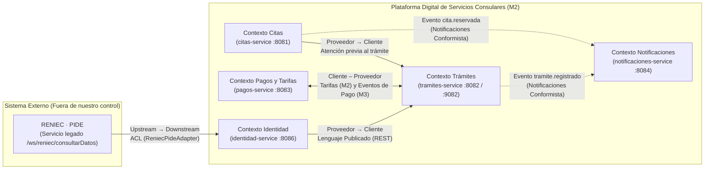

# Mapa de Contextos (*Context Map*) — Plataforma Digital Consular (M2)

Este documento describe los **Contextos Delimitados (*Bounded Contexts*)** de la plataforma consular y las relaciones estratégicas de integración entre ellos (sección 2.4 del curso).

---

## 1. Diagrama del Context Map

---

## 2. Relaciones Estratégicas entre Contextos

| Contexto Upstream (Proveedor) | Contexto Downstream (Consumidor) | Patrón de Context Map | Mecanismo Técnico y Justificación |
| --- | --- | --- | --- |
| **RENIEC · PIDE** *(Externo)* | **Identidad** (`identidad-service`) | **Capa Anticorrupción (*Anti-Corruption Layer – ACL*)** | `ReniecPideAdapter` y `ReniecPideTranslator` aíslan nuestro dominio de la nomenclatura legada (`coResultado`, `prenombres`, `inFallecido`), traduciéndola al modelo propio `Ciudadano`. |
| **Identidad** (`identidad-service`) | **Trámites** (coordinado vía `bff-web`) | **Servicio Abierto / Lenguaje Publicado (*Open Host Service / Published Language*)** | Expone `POST /api/identidad/validaciones` con un contrato limpio y estable (`CiudadanoDto`) consumido al iniciar un trámite. |
| **Citas** (`citas-service`) | **Trámites** (`tramites-service`) | **Proveedor – Cliente (*Upstream / Downstream*)** | El contexto de Citas provee la programación de atención presencial previa o complementaria a la gestión de trámites consulares. |
| **Trámites** (`tramites-service`) | **Pagos** (`pagos-service`) | **Cliente – Proveedor (*Customer – Supplier*)** |En M2 se consulta el arancel aplicable (`GET /api/tarifas`); en M3 ambos contextos colaboran mediante eventos (`pago.confirmado` / `pago.anulado`) dentro de la saga. |
| **Citas** y **Trámites** | **Notificaciones** (`notificaciones-service`) | **Conformista (*Conformist*) sobre Lenguaje Publicado de Eventos** | `notificaciones-service` se suscribe a `cita.reservada` y `tramite.registrado` en el exchange `consular.eventos`, adhiriéndose al esquema JSON publicado por los emisores sin exigir cambios en ellos. |

> [!IMPORTANT]
> **Por qué evitamos el *Shared Kernel* (Núcleo Compartido):**
> Ningún microservicio de `m2-integracion` comparte una librería `.jar` de dominio ni de infraestructura con otro (regla 04). Aunque cada servicio define su propio `PublicadorDeEventosPort` o su propio `TipoTramite`, esta duplicación intencional de tipos pequeños garantiza que cada Bounded Context pueda evolucionar y desplegarse de manera 100 % independiente sin acoplamiento binario.

---

## 3. Eventos de Dominio Publicados en el Context Map

| Evento (Routing Key) | Contexto Dueño (Emisor) | Consumidores | Naturaleza de la Integración |
| --- | --- | --- | --- |
| `cita.reservada` | **Citas** (`citas-service`) | **Notificaciones** (`notificaciones.cita.reservada`) | Asíncrona por eventos: el envío del correo de confirmación no debe bloquear ni revertir la reserva del cupo. |
| `tramite.registrado` | **Trámites** (`tramites-service`) | **Notificaciones** (`notificaciones.tramite.registrado`) | Asíncrona por eventos: el registro del trámite queda confirmado en `PENDIENTE_PAGO` aunque el servidor de correo o el consumidor de notificaciones esté temporalmente detenido. |

<!--
  NOTA PARA LA ASIGNACIÓN A2 (Tarea 1 Conceptual):
  Documente aquí el evento tramite.observado indicando:
  1. ¿Qué Bounded Context es dueño del hecho de negocio?
  2. ¿Por qué la comunicación hacia Notificaciones es asíncrona?
  3. ¿Qué relación del Context Map existe entre Trámites y Notificaciones frente a este evento?
-->

---

## 4. Para el Event Storming de la Sesión 3 (S3)

Durante la dinámica de *Event Storming* en clase, utilice la siguiente convención de colores de notas adhesivas para mapear el flujo consular de extremo a extremo:

| Color de Nota | Elemento de Event Storming | Ejemplo en el Caso Consular |
| --- | --- | --- |
| **Naranja** | **Evento de Dominio** (verbo en pasado) | `CitaReservada`, `TramiteRegistrado`, `PagoConfirmado`, `DocumentoEmitido` |
| **Azul** | **Comando** (acción intencional) | `ReservarCita`, `RegistrarTramite`, `ValidarIdentidad`, `ObservarTramite` |
| **Amarillo** | **Actor / Rol** | `Ciudadano en el Exterior`, `Funcionario Consular` |
| **Amarillo Claro (Ancho)** | **Agregado / Entidad Raíz** | `Cupo`, `Cita`, `Tramite`, `OrdenDePago` |
| **Rosa / Magenta** | **Sistema Externo** | `RENIEC · PIDE`, `Pasarela de Pagos`, `Servidor SMTP` |
| **Lila / Morado** | **Política / Regla Reactiva** (*"Cuando ocurre X, entonces Y"*) | *"Cuando ocurre `tramite.registrado`, enviar aviso por correo al ciudadano"* |
| **Verde** | **Modelo de Lectura (*Read Model*)** | `Disponibilidad del Día`, `Vista Inicio Ciudadano (BFF)` |

