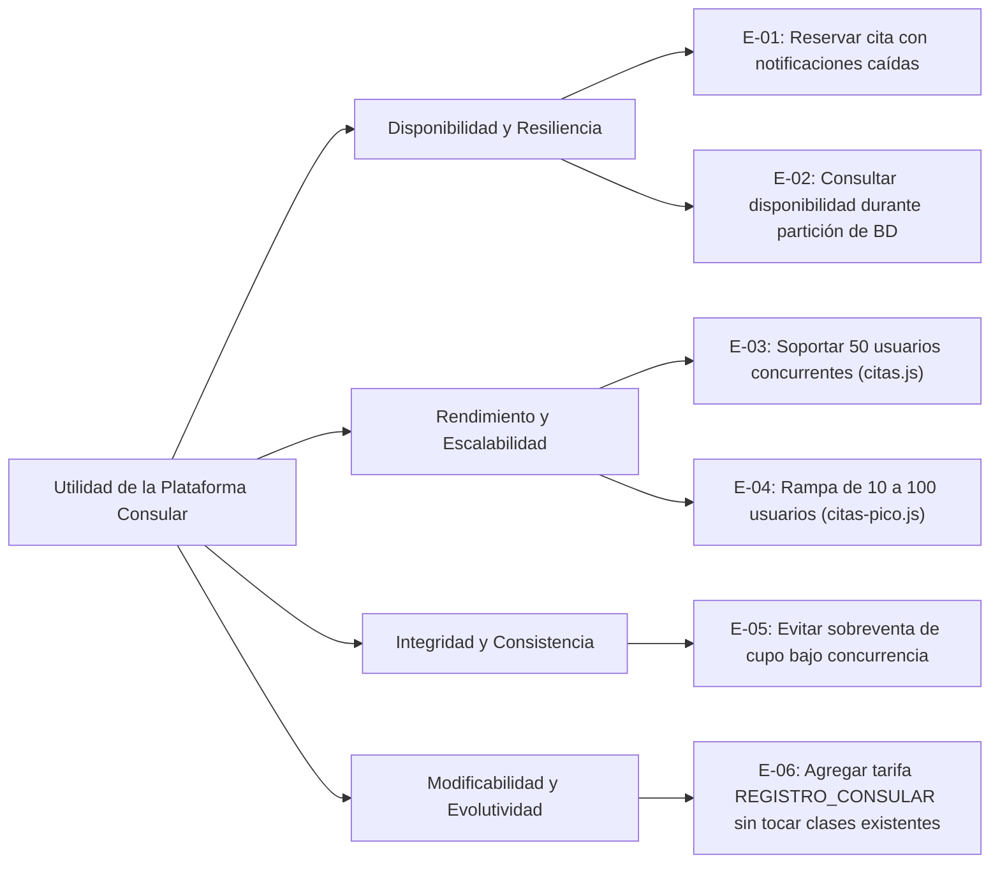

# Escenarios de Atributos de Calidad y Árbol de Utilidad (`m1-estilos`)

> **Sesión:** S1 — Sección 1.1 del sílabo (*Atributos de Calidad, Escenarios Cuantificables y Árbol de Utilidad*).

Un atributo de calidad no se especifica con adjetivos ambiguos (*"el sistema debe ser rápido y altamente disponible"*), sino mediante **escenarios de seis partes** verificables experimentalmente.

---

## 1. Plantilla de Escenario de Atributo de Calidad (6 Partes)

| Parte del Escenario | Pregunta Guía | Valor |
| --- | --- | --- |
| **1. Fuente del estímulo** | ¿Quién o qué genera el evento? (ciudadano, sistema externo, falla de infraestructura, pico de campaña) | *(completar)* |
| **2. Estímulo** | ¿Qué evento o condición llega al sistema? (solicitud de reserva, caída de un contenedor, partición de red) | *(completar)* |
| **3. Artefacto** | ¿Qué componente, servicio o base de datos recibe el estímulo? | *(completar)* |
| **4. Entorno** | ¿En qué estado operativo ocurre? (operación normal, carga pico de 100 usuarios, modo degradado sin servicio de notificaciones) | *(completar)* |
| **5. Respuesta** | ¿Qué hace el sistema ante el estímulo? (confirma la cita con estado `PENDIENTE`, sirve desde caché, rechaza con `409`) | *(completar)* |
| **6. Medida de la respuesta** | ¿Cómo se mide objetivamente que la respuesta es satisfactoria? (latencia `p95 < 2 s`, tiempo de respuesta `< 3 s`, `0` sobreventas) | *(completar)* |

---

## 2. Ejemplo Resuelto del Caso Consular

### Escenario E-01: Continuidad de la reserva de citas ante caída del servicio de notificaciones

| Parte del Escenario | Especificación en la Plataforma Consular |
| --- | --- |
| **1. Fuente del estímulo** | Ciudadano en el exterior a través del portal web (`http://localhost:4200`). |
| **2. Estímulo** | Solicita registrar una cita consular (`POST /api/citas`) cuando el subsistema de notificaciones no responde. |
| **3. Artefacto** | Servicio de Citas (`m1-citas` en microservicios / `m1-fn-reservar` en serverless) y su adaptador de salida de notificaciones. |
| **4. Entorno** | Operación degradada: el contenedor `m1-notificaciones` (o `m1-fn-notificar`) se encuentra detenido o inalcanzable en la red. |
| **5. Respuesta** | El servicio de citas persiste la cita en estado `RESERVADA`, aplica el mecanismo de aislamiento (*Circuit Breaker* / invocación asíncrona con timeout) y registra el estado de notificación como `PENDIENTE` sin abortar la reserva del ciudadano. |
| **6. Medida de la respuesta** | La petición `POST /api/citas` responde HTTP `201 Created` con `"notificacion": "PENDIENTE"` en un tiempo total **menor a 3 segundos** (`< 3000 ms` en microservicios y `< 500 ms` en serverless), con **0 %** de pérdida de reservas válidas. |

---

## 3. Árbol de Utilidad para Completar en Clase (S1)

Clasifique cada escenario según dos dimensiones en la tupla **`(Importancia para el negocio, Dificultad técnica / riesgo arquitectónico)`** usando la escala **`Alta (A)`**, **`Media (M)`** o **`Baja (B)`** (por ejemplo, `(A, A)` para los impulsores arquitectónicos críticos):

| ID | Atributo de Calidad | Refinamiento | Descripción del Escenario y Medida | Importancia (`Alta`/`Media`/`Baja`) | Dificultad (`Alta`/`Media`/`Baja`) | ¿Es impulsor arquitectónico? |
| --- | --- | --- | --- | --- | --- | --- |
| **E-01** | Disponibilidad | Degradación elegante | Al caer `notificaciones`, `POST /api/citas` confirma la cita (`201`, `notificacion: PENDIENTE`) en `< 3 s`. | `Alta` | `Media` | Sí (define desacoplamiento S1) |
| **E-02** | Disponibilidad | Tolerancia a particiones (AP) | Ante desconexión de `m1_datos`, `GET /disponibilidad` en modo `AP` responde desde caché en `< 200 ms` indicando `origen: CACHE`. | *(completar)* | *(completar)* | *(completar)* |
| **E-03** | Rendimiento | Latencia bajo carga nominal | Con 50 VUs durante 60 s (80 % consultas, 20 % reservas), el percentil 95 (`p95`) se mantiene `< 2000 ms` y la tasa de error real `< 5 %`. | *(completar)* | *(completar)* | *(completar)* |
| **E-04** | Escalabilidad | Absorción de picos | En una rampa de 10 a 100 VUs (`citas-pico.js`), el sistema procesa las solicitudes sin caídas de contenedor (`OOM` / `503`). | *(completar)* | *(completar)* | *(completar)* |
| **E-05** | Integridad | Consistencia de cupos (CP) | Ante 20 solicitudes simultáneas por el último cupo libre, exactamente 1 recibe `201 Created` y 19 reciben `409 Conflict` (`0` sobreventas). | *(completar)* | *(completar)* | *(completar)* |
| **E-06** | Modificabilidad | Extensibilidad (OCP / Strategy) | Incorporar el cálculo de tarifa para `REGISTRO_CONSULAR` añadiendo una sola clase `TarifaStrategy` en `< 15 min` sin modificar `CalculadoraDeTarifas`. | *(completar)* | *(completar)* | *(completar)* |

