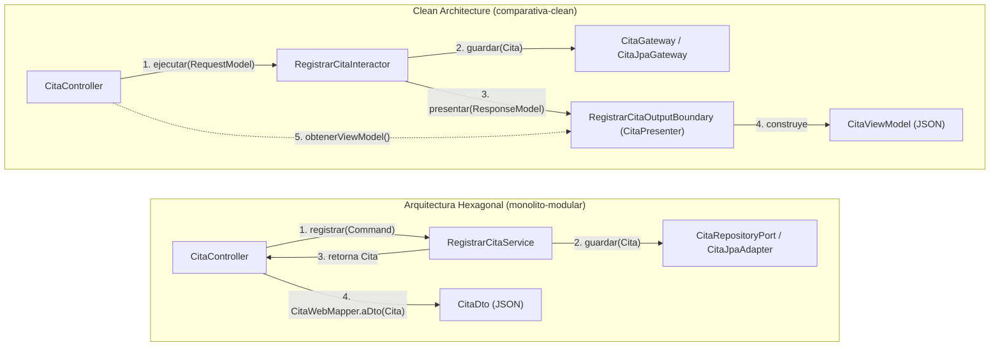

# Matriz Comparativa S2: Arquitectura Hexagonal vs. Clean Architecture (`m1-estilos`)

> **Sesión:** S2 — Sección 1.3 del sílabo (*Arquitectura Hexagonal / Puertos y Adaptadores vs. Clean Architecture*).
> **Proyectos a abrir lado a lado en Eclipse:**
> - **Hexagonal (`consular-monolito`):** `m1-estilos/monolito-modular`
> - **Clean Architecture (`consular-clean`):** `m1-estilos/comparativa-clean`

Ambos proyectos implementan **exactamente la misma API REST** en `http://localhost:8081`, conectan al mismo esquema PostgreSQL (`citas` y `tramites`) y cumplen los mismos contratos de negocio y errores (RFC 9457 `ProblemDetail`). La única diferencia observable desde afuera está en `GET /api/sistema/info` (`"arquitecturaInterna": "HEXAGONAL"` vs. `"CLEAN"`).

---

## 1. Tabla de Equivalencias con Rutas Reales

| Rol Arquitectónico | Arquitectura Hexagonal (`monolito-modular`) | Clean Architecture (`comparativa-clean`) | Diferencia Clave |
| --- | --- | --- | --- |
| **Punto de entrada Spring Boot** | `m1-estilos/monolito-modular/src/main/java/pe/utec/consular/monolito/MonolitoApplication.java` | `m1-estilos/comparativa-clean/src/main/java/pe/utec/consular/clean/CleanApplication.java` | Ambos inician en `:8081` y habilitan propiedades de laboratorio (`consistencia.*`, `notificaciones.*`). |
| **Entidad de negocio principal (Citas)** | `m1-estilos/monolito-modular/src/main/java/pe/utec/consular/monolito/citas/domain/Cita.java` | `m1-estilos/comparativa-clean/src/main/java/pe/utec/consular/clean/citas/entities/Cita.java` | En Hexagonal vive en `domain/`; en Clean vive en el círculo más interno `entities/`. Ninguna depende de JPA ni Spring. |
| **Entidad Cupo (concurrencia)** | `m1-estilos/monolito-modular/src/main/java/pe/utec/consular/monolito/citas/domain/Cupo.java` | `m1-estilos/comparativa-clean/src/main/java/pe/utec/consular/clean/citas/entities/Cupo.java` | Invariantes idénticas (`reservar()`, `liberar()`, `cuposLibres()`). |
| **Entidad Oficina Consular** | `m1-estilos/monolito-modular/src/main/java/pe/utec/consular/monolito/citas/domain/OficinaConsular.java` | `m1-estilos/comparativa-clean/src/main/java/pe/utec/consular/clean/citas/entities/OficinaConsular.java` | Mismo modelo inmutable de sede consular. |
| **Reglas empresariales de reserva** | `m1-estilos/monolito-modular/src/main/java/pe/utec/consular/monolito/citas/domain/ReglasDeReserva.java` | `m1-estilos/comparativa-clean/src/main/java/pe/utec/consular/clean/citas/entities/ReglasDeReserva.java` | Validación pura de ventana temporal (mañana a 30 días) y no duplicidad. |
| **Contrato de entrada del caso de uso** | **Puerto Primario (In Port):**<br>`m1-estilos/monolito-modular/src/main/java/pe/utec/consular/monolito/citas/application/port/in/RegistrarCitaUseCase.java` | **Input Boundary:**<br>`m1-estilos/comparativa-clean/src/main/java/pe/utec/consular/clean/citas/usecase/registrar/RegistrarCitaInputBoundary.java` | `RegistrarCitaUseCase.registrar(cmd)` **retorna `Cita`**; `RegistrarCitaInputBoundary.ejecutar(req)` **retorna `void`** y delega la salida al `OutputBoundary`. |
| **Datos de entrada al caso de uso** | **Command:**<br>`m1-estilos/monolito-modular/src/main/java/pe/utec/consular/monolito/citas/application/port/in/RegistrarCitaCommand.java` | **Request Model:**<br>`m1-estilos/comparativa-clean/src/main/java/pe/utec/consular/clean/citas/usecase/registrar/RegistrarCitaRequestModel.java` | Ambos son `record` inmutables libres de anotaciones HTTP/Jackson. |
| **Implementación del caso de uso** | **Application Service:**<br>`m1-estilos/monolito-modular/src/main/java/pe/utec/consular/monolito/citas/application/service/RegistrarCitaService.java` | **Use Case Interactor:**<br>`m1-estilos/comparativa-clean/src/main/java/pe/utec/consular/clean/citas/usecase/registrar/RegistrarCitaInteractor.java` | `RegistrarCitaService` lleva `@Service` y `@Transactional`; `RegistrarCitaInteractor` **no tiene ninguna anotación de Spring** y entrega el resultado a `RegistrarCitaOutputBoundary`. |
| **Contrato de salida hacia la presentación** | *(No existe; el servicio retorna `Cita` directamente al controlador)* | **Output Boundary + Response Model:**<br>`m1-estilos/comparativa-clean/src/main/java/pe/utec/consular/clean/citas/usecase/registrar/RegistrarCitaOutputBoundary.java`<br>`m1-estilos/comparativa-clean/src/main/java/pe/utec/consular/clean/citas/usecase/registrar/RegistrarCitaResponseModel.java` | En Clean Architecture el caso de uso empuja un `ResponseModel` hacia una interfaz (`OutputBoundary`) implementada por el `Presenter`. |
| **Transformación a modelo de vista (JSON)** | **Web Mapper + DTO:**<br>`m1-estilos/monolito-modular/src/main/java/pe/utec/consular/monolito/citas/adapter/in/web/CitaWebMapper.java`<br>`m1-estilos/monolito-modular/src/main/java/pe/utec/consular/monolito/citas/adapter/in/web/CitaDto.java` | **Presenter + ViewModel:**<br>`m1-estilos/comparativa-clean/src/main/java/pe/utec/consular/clean/citas/interfaceadapters/presenter/CitaPresenter.java`<br>`m1-estilos/comparativa-clean/src/main/java/pe/utec/consular/clean/citas/interfaceadapters/presenter/CitaViewModel.java` | En Clean Architecture el `CitaPresenter` implementa `RegistrarCitaOutputBoundary` y construye el `CitaViewModel` que el controlador recupera. |
| **Controlador REST (Citas)** | **Primary Web Adapter:**<br>`m1-estilos/monolito-modular/src/main/java/pe/utec/consular/monolito/citas/adapter/in/web/CitaController.java` | **Interface Adapter Controller:**<br>`m1-estilos/comparativa-clean/src/main/java/pe/utec/consular/clean/citas/interfaceadapters/controller/CitaController.java` | En Hexagonal llama a `useCase.registrar(cmd)` y mapea el retorno; en Clean llama a `inputBoundary.ejecutar(req)` y pide el `ViewModel` a `citaPresenter.obtenerViewModel()`. |
| **Contratos hacia persistencia y notificaciones** | **Puertos Secundarios (Out Ports):**<br>`m1-estilos/monolito-modular/src/main/java/pe/utec/consular/monolito/citas/application/port/out/CitaRepositoryPort.java`<br>`.../CupoRepositoryPort.java`<br>`.../OficinaRepositoryPort.java`<br>`.../NotificacionPort.java` | **Gateways (en `usecase`):**<br>`m1-estilos/comparativa-clean/src/main/java/pe/utec/consular/clean/citas/usecase/CitaGateway.java`<br>`.../CupoGateway.java`<br>`.../OficinaGateway.java`<br>`.../NotificadorGateway.java` | Ambos aplican Inversión de Dependencias (DIP): la interfaz pertenece al núcleo (`application.port.out` vs. `usecase`). |
| **Implementación de persistencia y notificación** | **Secondary Adapters:**<br>`m1-estilos/monolito-modular/src/main/java/pe/utec/consular/monolito/citas/adapter/out/persistence/CitaJpaAdapter.java`<br>`.../CupoJpaAdapter.java`<br>`.../OficinaJpaAdapter.java`<br>`.../notificaciones/NotificacionModuloAdapter.java` | **Interface Adapter Gateways:**<br>`m1-estilos/comparativa-clean/src/main/java/pe/utec/consular/clean/citas/interfaceadapters/gateway/CitaJpaGateway.java`<br>`.../CupoJpaGateway.java`<br>`.../OficinaJpaGateway.java`<br>`.../NotificadorConsolaGateway.java` | En Clean Architecture los Gateways viven en `interfaceadapters.gateway` (Círculo 3) y las entidades/repositorios Spring Data viven en `frameworks.persistence` (Círculo 4). |
| **Entidades JPA y Repositorios Spring Data** | `m1-estilos/monolito-modular/src/main/java/pe/utec/consular/monolito/citas/adapter/out/persistence/CitaJpaEntity.java`<br>`.../SpringDataCitaRepository.java` | `m1-estilos/comparativa-clean/src/main/java/pe/utec/consular/clean/citas/frameworks/persistence/CitaJpaEntity.java`<br>`.../SpringDataCitaRepository.java` | En Clean Architecture se ubican explícitamente en el círculo más externo (`frameworks.persistence`). |
| **Ensamblado de dependencias (IoC)** | Escaneo implícito con `@Service` / `@Component` en servicios y adaptadores | **Configuración explícita `@Bean`:**<br>`m1-estilos/comparativa-clean/src/main/java/pe/utec/consular/clean/citas/frameworks/config/CleanArchitectureBeansConfig.java`<br>`m1-estilos/comparativa-clean/src/main/java/pe/utec/consular/clean/tarifas/frameworks/config/TarifasBeansConfig.java` | En Clean Architecture los `Interactor` y `Entities` no llevan anotaciones de Spring; se ensamblan en `frameworks.config`. |
| **Patrón Strategy (Tarifas)** | `m1-estilos/monolito-modular/src/main/java/pe/utec/consular/monolito/tramites/domain/tarifa/TarifaStrategy.java`<br>`.../CalculadoraDeTarifas.java` | `m1-estilos/comparativa-clean/src/main/java/pe/utec/consular/clean/tarifas/entities/TarifaStrategy.java`<br>`.../CalculadoraDeTarifas.java` | Mismo principio Abierto/Cerrado (OCP), ensamblado mediante `@Bean` en `TarifasBeansConfig`. |
| **Pruebas de Arquitectura (ArchUnit)** | `m1-estilos/monolito-modular/src/test/java/pe/utec/consular/monolito/ReglasDeArquitecturaTest.java` | `m1-estilos/comparativa-clean/src/test/java/pe/utec/consular/clean/ReglasDeArquitecturaTest.java` | Hexagonal valida `domain` / `application` / `adapter`; Clean valida los 4 círculos concéntricos (`entities` ← `usecase` ← `interfaceadapters` ← `frameworks`). |

---

## 2. Comparación del Flujo de Control al Reservar una Cita (`POST /api/citas`)



---

## 3. Ejercicio Práctico en Clase y Preguntas Guía (Sesión 2)

### 3.1 Experimento en vivo: romper la Regla de Dependencia Concéntrica
1. Abra `m1-estilos/comparativa-clean/src/main/java/pe/utec/consular/clean/citas/entities/Cita.java`.
2. Agregue en la parte superior del archivo:
   ```java
   import jakarta.persistence.Entity;
   ```
3. Ejecute `ReglasDeArquitecturaTest` desde Eclipse (*Run As → JUnit Test*) o con Maven (`mvn test -pl comparativa-clean`).
4. Observe cómo falla la regla `entities_no_depende_de_nadie` con el mensaje en español indicando la línea exacta donde el círculo `entities` importó un framework externo (`jakarta.persistence.Entity`).
5. Revierta el cambio y verifique que la prueba vuelve a pasar en verde.

### 3.2 Preguntas Guía para Discusión en S2
1. **Anotaciones en casos de uso:** ¿Qué ventaja e inconveniente concreto tiene no usar `@Service` ni `@Transactional` en `RegistrarCitaInteractor` y delegar el ensamblado a `CleanArchitectureBeansConfig` frente a anotar directamente `RegistrarCitaService` en el monolito hexagonal?
2. **Retorno directo vs. Output Boundary + Presenter:** ¿En qué escenarios reales justifica su costo adicional tener un `OutputBoundary` (`CitaPresenter`) separado del `Controller` (por ejemplo, múltiples formatos de presentación o transformación compleja de estado de vista), y cuándo resulta suficiente el enfoque hexagonal de devolver la entidad/resultado y mapearlo en `adapter.in.web`?
3. **Granularidad de paquetes y costo cognitivo:** Compare la cantidad de clases necesarias para el caso de uso *Registrar Cita* en ambos proyectos. ¿Qué impacto tiene cada estilo en la velocidad de incorporación de nuevos desarrolladores al equipo?
4. **Gobernanza automatizada:** ¿Por qué una regla de ArchUnit en el pipeline de CI (`ReglasDeArquitecturaTest`) es más efectiva que un documento de estándares en PDF para evitar que las entidades JPA se filtren hacia las reglas de negocio?

