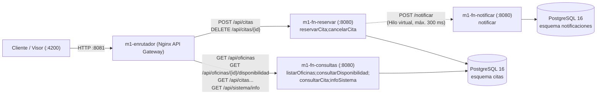

# M1 :: Variante Serverless (Emulada Localmente)

## Propósito Pedagógico

Esta variante demuestra el estilo arquitectónico **Serverless / Function-as-a-Service (FaaS)**:

- **Una función por operación de negocio** (`java.util.function.Supplier`, `Function`, `Consumer`), sin estado en memoria entre invocaciones (*stateless*).
- **Activación por eventos HTTP** a través de un enrutador frontal (`m1-enrutador` con Nginx en `:8081`) que actúa como equivalente local de un **API Gateway** de nube (AWS API Gateway / Azure API Management) e inyecta la cabecera `X-Funcion-Invocada` en cada respuesta.
- **Misma imagen, activación selectiva**: Una única aplicación empaquetada (`consular-m1-funciones-citas`) se despliega en múltiples contenedores aislando qué funciones están activas mediante `SPRING_CLOUD_FUNCTION_DEFINITION`.
- **Invocación asíncrona con presupuesto de latencia estricto**: `reservarCita` invoca a la función `notificar` en un **hilo virtual** (`RestClient` asíncrono) esperando como máximo **300 ms**. Si `notificar` responde en `< 300 ms`, la cita se registra con `notificacion: ENVIADA`; si falla o supera `300 ms`, responde inmediatamente `201 Created` con `notificacion: PENDIENTE`.
- **Observabilidad de arranque en frío (*cold start*)**: Al iniciar cada contenedor se registra explícitamente en el log: `Función lista en N ms`.

> **Nota importante sobre la emulación local vs. nube pública:**
> En un proveedor de nube real (AWS Lambda o Azure Functions), cada una de las 7 funciones se desplegaría como una unidad de ejecución independiente que escala a cero cuando no recibe tráfico. En este entorno de laboratorio local se agrupan en **3 contenedores** (`m1-fn-consultas`, `m1-fn-reservar`, `m1-fn-notificar`) para no exceder la memoria RAM del equipo del participante.

---

## Catálogo de Funciones y Enrutamiento



| Función (`@Bean`) | Tipo Java | Ruta pública en `:8081` | Contenedor | Cabecera `X-Funcion-Invocada` |
| --- | --- | --- | --- | --- |
| `listarOficinas` | `Supplier<List<OficinaDto>>` | `GET /api/oficinas` | `m1-fn-consultas` | `listarOficinas` |
| `consultarDisponibilidad` | `Function<Message<?>, DisponibilidadDto>` | `GET /api/oficinas/{id}/disponibilidad?fecha=` | `m1-fn-consultas` | `consultarDisponibilidad` |
| `consultarCita` | `Function<Message<?>, Object>` | `GET /api/citas/{id}` y `GET /api/citas?dni=` | `m1-fn-consultas` | `consultarCita` |
| `reservarCita` | `Function<RegistrarCitaRequest, CitaDto>` | `POST /api/citas` | `m1-fn-reservar` | `reservarCita` |
| `cancelarCita` | `Function<Message<?>, Void>` | `DELETE /api/citas/{id}` | `m1-fn-reservar` | `cancelarCita` |
| `notificar` | `Consumer<AvisoRequest>` | *(interna)* `POST /notificar` | `m1-fn-notificar` | *(interna)* |
| `infoSistema` | `Supplier<InfoSistemaDto>` | `GET /api/sistema/info` | `m1-fn-consultas` | `infoSistema` |

> **Alcance funcional**: Al igual que en la variante de microservicios de M1, el endpoint `/api/tarifas` no forma parte de este despliegue enfocado en el flujo crítico de reserva de citas y notificaciones.

---

## Adaptador para Despliegue en Nube Real (AWS Lambda)

El proyecto [`funciones-citas/pom.xml`](./funciones-citas/pom.xml) incluye el perfil opcional `aws` con el adaptador oficial `spring-cloud-function-adapter-aws`. No es requisito para ejecutar en local, pero permite empaquetar las mismas funciones sin modificar una sola línea de código Java para demostrarlas en AWS Lambda:

```bash
mvn -B -f m1-estilos package -pl serverless/funciones-citas -Paws -DskipTests
```

En AWS Lambda se configura el manejador `org.springframework.cloud.function.adapter.aws.FunctionInvoker::handleRequest` y la variable de entorno `SPRING_CLOUD_FUNCTION_DEFINITION` con el nombre de la función individual (por ejemplo, `reservarCita`).

---

## Ejecución de Pruebas Automatizadas

Desde la raíz del repositorio:

```bash
mvn -B -f m1-estilos verify -pl serverless/funciones-citas
```

---

## Ejecución Local con Docker Compose (Perfil `serverless`)

### 1. Levantar los contenedores

```bash
docker compose -f m1-estilos/docker-compose.dev.yml --profile serverless up -d --build
```

### 2. Verificar el tiempo de arranque en frío (*cold start*) en los logs

```bash
docker logs m1-fn-consultas | grep "Función lista en"
docker logs m1-fn-reservar  | grep "Función lista en"
docker logs m1-fn-notificar | grep "Función lista en"
```

### 3. Probar la API pública en `:8081` (incluyendo cabecera `X-Funcion-Invocada`)

```bash
# Información del sistema (variante: SERVERLESS)
curl -i http://localhost:8081/api/sistema/info

# Listar oficinas consulares
curl -i http://localhost:8081/api/oficinas

# Consultar disponibilidad de una oficina
curl -i "http://localhost:8081/api/oficinas/MAD/disponibilidad?fecha=2026-11-18"

# Reservar una cita (responde 201 Created con notificacion: ENVIADA si m1-fn-notificar responde en < 300 ms)
curl -i -X POST http://localhost:8081/api/citas \
  -H "Content-Type: application/json" \
  -d '{
    "dni": "45678912",
    "nombres": "Ana Quispe Rojas",
    "email": "ana.quispe@ejemplo.pe",
    "oficinaId": "MAD",
    "tipoTramite": "PASAPORTE",
    "fecha": "2026-11-18",
    "hora": "10:30"
  }'

# Consultar citas por DNI
curl -i "http://localhost:8081/api/citas?dni=45678912"
```

### 4. Demostración de Tolerancia a Fallos (Caída de `m1-fn-notificar`)

```bash
# Detener la función de notificaciones
docker stop m1-fn-notificar

# Reservar otra cita -> responde 201 Created en ~300 ms con "notificacion": "PENDIENTE"
curl -i -X POST http://localhost:8081/api/citas \
  -H "Content-Type: application/json" \
  -d '{
    "dni": "45678913",
    "nombres": "Carlos Mendoza",
    "email": "carlos.mendoza@ejemplo.pe",
    "oficinaId": "MAD",
    "tipoTramite": "PASAPORTE",
    "fecha": "2026-11-18",
    "hora": "11:00"
  }'
```

### 5. Detener y eliminar los contenedores al finalizar

```bash
docker compose -f m1-estilos/docker-compose.dev.yml --profile serverless down -v --remove-orphans
```

