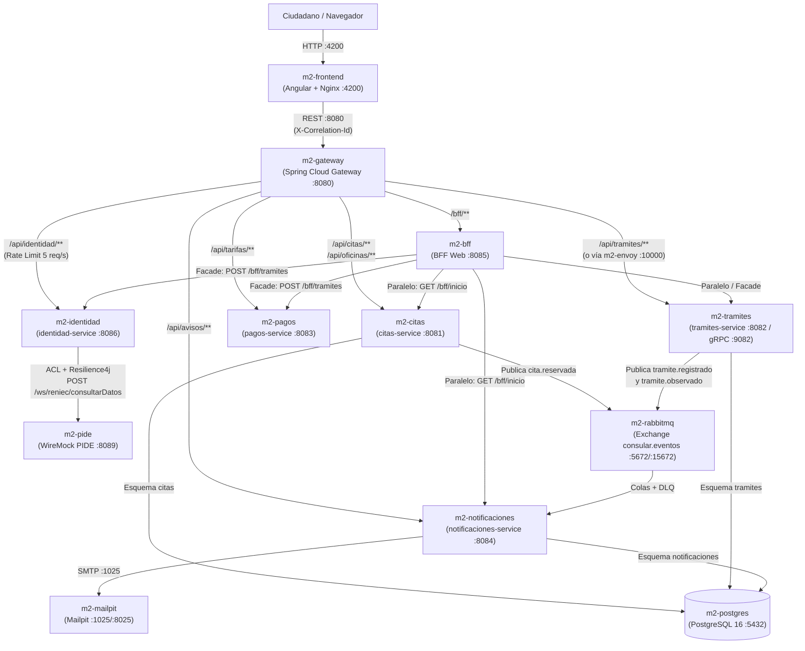

# Módulo 2 (`m2-integracion`) — Integración, Patrones, Eventos, gRPC, BFF, API Gateway y Sidecar

Este módulo materializa la arquitectura distribuida de integración y comunicación de la **Plataforma Digital de Servicios Consulares y de Legalización** para las sesiones **S2 y S3**.

---

## 1. Arquitectura de Contenedores del Módulo 2



---

## 2. Tabla de Puertos y Servicios

> **Importante:** Detenga cualquier variante de `m1-estilos` (`..\m1-estilos\scripts\limpiar.ps1 -Forzar`) antes de levantar `m2-integracion`, ya que comparten los puertos `4200`, `5432`, `8025` y `8081`.

| Contenedor | Servicio | Puerto(s) Host | URL Principal / Consola |
| --- | --- | --- | --- |
| `m2-frontend` | Frontend Ciudadano (Modo M2) | `4200` | `http://localhost:4200` |
| `m2-gateway` | API Gateway (Entrada única + Swagger agregado) | `8080` | `http://localhost:8080/swagger-ui.html` |
| `m2-citas` | `citas-service` | `8081` | `http://localhost:8081/swagger-ui.html` |
| `m2-tramites` | `tramites-service` (HTTP REST + gRPC) | `8082`, `9082` | `http://localhost:8082/swagger-ui.html` / `localhost:9082` |
| `m2-pagos` | `pagos-service` (Patrón Strategy) | `8083` | `http://localhost:8083/swagger-ui.html` |
| `m2-notificaciones` | `notificaciones-service` (Consumidores + DLQ) | `8084` | `http://localhost:8084/swagger-ui.html` |
| `m2-bff` | `bff-web` (Agregación paralela + Facade) | `8085` | `http://localhost:8085/swagger-ui.html` |
| `m2-identidad` | `identidad-service` (Adapter + ACL PIDE) | `8086` | `http://localhost:8086/swagger-ui.html` |
| `m2-pide` | Simulador PIDE · RENIEC (WireMock) | `8089` | `http://localhost:8089/__admin/mappings` |
| `m2-envoy` | Sidecar Envoy (perfil `sidecar`) | `10000`, `9901` | `http://localhost:9901/stats` |
| `m2-rabbitmq` | RabbitMQ 3 Management (`consular` / `consular`) | `5672`, `15672` | `http://localhost:15672` |
| `m2-mailpit` | Mailpit SMTP / Web | `1025`, `8025` | `http://localhost:8025` |
| `m2-postgres` | PostgreSQL 16 (`consular`) | `5432` | `localhost:5432` |

---

## 3. Experimentos Guiados de la Sesión 3 (En el Orden del Laboratorio)

### Paso 1: Levantar el entorno completo de M2
```powershell
cd m2-integracion
.\scripts\levantar.ps1
```

### Paso 2: Seguir el `X-Correlation-Id` a través de 4 microservicios (`POST /bff/tramites`)
```powershell
$corr = "corr-lab-s3-001"
$tramite = Invoke-RestMethod -Uri "http://localhost:8080/bff/tramites" -Method Post `
    -Headers @{ "X-Correlation-Id" = $corr } -ContentType "application/json; charset=utf-8" `
    -Body '{"dni":"40000001","email":"ana@correo.lab","tipoTramite":"APOSTILLA","pais":"ES","folios":2,"idioma":"ES"}'
$tramite | ConvertTo-Json -Depth 4

# Verificar la misma traza en los logs de los 4 contenedores involucrados
foreach ($c in @("m2-gateway","m2-bff","m2-identidad","m2-tramites")) {
    Write-Host "=== $c ===" -ForegroundColor Cyan
    docker logs $c 2>&1 | Select-String $corr
}
```

### Paso 3: Probar la Capa Anticorrupción (ACL) frente a los 3 casos de DNI en la PIDE simulada
```powershell
# 1. DNI válido (40000001..40000050) -> 200 OK con modelo propio Ciudadano
Invoke-RestMethod -Uri "http://localhost:8080/api/identidad/validaciones" -Method Post -ContentType "application/json" -Body '{"dni":"40000001"}'

# 2. DNI fallecido (49999999) -> 422 "Identidad no vigente"
try { Invoke-WebRequest -Uri "http://localhost:8080/api/identidad/validaciones" -Method Post -ContentType "application/json" -Body '{"dni":"49999999"}' -UseBasicParsing } catch { Write-Host "HTTP:" ([int]$_.Exception.Response.StatusCode) }

# 3. DNI inexistente (48888888) -> 404 "DNI no encontrado"
try { Invoke-WebRequest -Uri "http://localhost:8080/api/identidad/validaciones" -Method Post -ContentType "application/json" -Body '{"dni":"48888888"}' -UseBasicParsing } catch { Write-Host "HTTP:" ([int]$_.Exception.Response.StatusCode) }
```

### Paso 4: Desacoplamiento temporal y degradación elegante (`docker stop m2-notificaciones`)
```powershell
# 1. Detener el consumidor de notificaciones
docker stop m2-notificaciones

# 2. Consultar Mi Espacio en el BFF -> responde 200 OK con avisos=[] y aviso de degradación
Invoke-RestMethod -Uri "http://localhost:8080/bff/inicio?dni=40000001" | ConvertTo-Json -Depth 4

# 3. Registrar 3 trámites mientras notificaciones está detenido -> los 3 mensajes esperan en RabbitMQ
1..3 | ForEach-Object {
    Invoke-RestMethod -Uri "http://localhost:8080/api/tramites" -Method Post -ContentType "application/json" `
        -Body "{`"dni`":`"4000000$_`",`"nombres`":`"Ciudadano $_`",`"email`":`"c$_@correo.lab`",`"tipoTramite`":`"LEGALIZACION`",`"pais`":`"ES`",`"folios`":1,`"idioma`":`"ES`"}" | Out-Null
}

# 4. Volver a iniciar m2-notificaciones -> drena la cola y entrega los 3 correos en Mailpit (:8025)
docker start m2-notificaciones
```

### Paso 5: Comparar REST (JSON) vs. gRPC (Protobuf)
```powershell
.\scripts\grpc-consultar.ps1 $tramite.id
```

### Paso 6: Patrón Sidecar con Envoy y Fallas Intermitentes al 50 %
```powershell
# Levantar el perfil sidecar inyectando 50 % de fallas intermitentes en tramites-service
# y apuntando la ruta de trámites del gateway hacia el sidecar m2-envoy:10000
$env:FALLAS_INTERMITENTES_PORCENTAJE = "50"
$env:TRAMITES_GATEWAY_URL = "http://envoy:10000"
docker compose --profile sidecar up -d

# Ejecutar 20 consultas seguidas a través del gateway: todas responden 200 OK gracias a los reintentos de Envoy
1..20 | ForEach-Object {
    $r = Invoke-WebRequest -Uri "http://localhost:8080/api/tramites/$($tramite.id)" -UseBasicParsing
    Write-Host "Solicitud $_ -> HTTP $($r.StatusCode)"
}

# Inspeccionar contadores de reintentos (upstream_rq_retry) en la administración de Envoy (:9901)
Invoke-RestMethod -Uri "http://localhost:9901/stats?filter=tramites_cluster.upstream_rq_retry"
```

---

## 4. Modo Híbrido en Eclipse / Spring Tools Suite

Para depurar cualquiera de los microservicios desde su IDE conservando PostgreSQL, RabbitMQ, Mailpit, PIDE y el resto del ecosistema en Docker:

1. Levante el entorno con `.\scripts\levantar.ps1`.
2. Detenga únicamente el contenedor del servicio que desea depurar desde Eclipse, por ejemplo:
   ```powershell
   docker stop m2-tramites
   ```
3. En **Eclipse / STS**, importe `m2-integracion` como proyecto Maven existente y ejecute `TramitesApplication.java` con el perfil de Spring **`local`** (`-Dspring.profiles.active=local`).

---

## 5. Memoria Medida por Contenedor (`docker stats`)

| Contenedor | Límite Configurado (`mem_limit`) | Uso Medido en Reposo / Carga Moderada |
| --- | --- | --- |
| `m2-postgres` | — | `~34 MiB` |
| `m2-rabbitmq` | — | `~112 MiB` |
| `m2-mailpit` | — | `~16 MiB` |
| `m2-pide` | `256 MiB` | `~128 MiB` |
| `m2-citas` | `512 MiB` | `~195 MiB` |
| `m2-tramites` | `512 MiB` | `~210 MiB` |
| `m2-pagos` | `384 MiB` | `~155 MiB` |
| `m2-notificaciones` | `512 MiB` | `~198 MiB` |
| `m2-identidad` | `512 MiB` | `~168 MiB` |
| `m2-bff` | `384 MiB` | `~162 MiB` |
| `m2-gateway` | `384 MiB` | `~170 MiB` |
| `m2-frontend` | `128 MiB` | `~11 MiB` |
| **Total Módulo 2** | **< 4.0 GB** | **`~1.56 GiB` (cumple holgadamente el tope de $\le 6\text{ GB}$ de la Regla 03)** |

---

## 6. Asignación A2 y Artefactos Relacionados

- Guía de la asignación evaluada: [docs/asignaciones/A2.md](../docs/asignaciones/A2.md)
- Lenguaje ubicuo por contexto: [docs/ddd/lenguaje-ubicuo.md](../docs/ddd/lenguaje-ubicuo.md)
- Mapa de contextos (*Context Map*): [docs/ddd/context-map.md](../docs/ddd/context-map.md)
- Contrato de eventos AsyncAPI 3: [docs/contratos/asyncapi.yaml](../docs/contratos/asyncapi.yaml)
- Colección Postman de M2: [docs/pruebas/colecciones/m2.postman_collection.json](../docs/pruebas/colecciones/m2.postman_collection.json)

