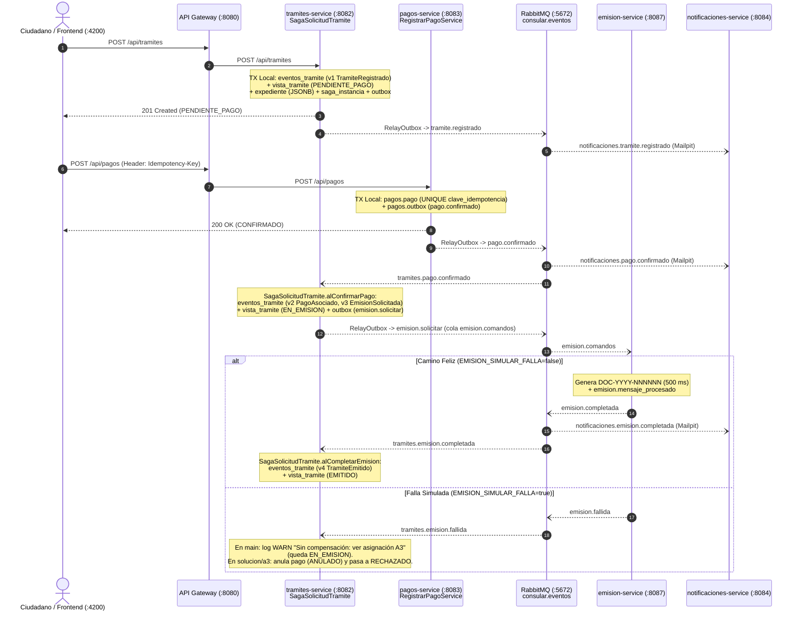

# Módulo 3 (`m3-datos`) — Gestión de Datos, Consistencia Distribuida y Optimización

El **Módulo 3 (`m3-datos`)** cubre las **Sesiones 4 y 5** del curso **Arquitectura de Software y Diseño de Soluciones**:

- **3.1 SQL vs. NoSQL y *Database-per-Service***: Aislamiento estricto por esquema y usuario en PostgreSQL (`01-esquemas.sql`), modelo documental `JSONB` con índice `GIN` (`tramites.expediente`), y Redis (`m3-redis`, `:6379`).
- **3.2 Event Sourcing y CQRS**: Registro inmutable de eventos en `tramites.eventos_tramite`, reconstrucción del agregado `Tramite` con concurrencia optimista por versión, proyección desnormalizada en `tramites.vista_tramite` (`ProyectorVistaTramite`) y reconstrucción determinista.
- **3.3 Saga Orquestada, Transactional Outbox e Idempotencia**: Orquestador `SagaSolicitudTramite` (`tramites-service`), relés de Outbox (`RelayOutbox` en `tramites-service` y `pagos-service`), pagos idempotentes con `Idempotency-Key` (`RegistrarPagoService`) y `emision-service` (`:8087`) con consumidor idempotente (`emision.mensaje_procesado`).
- **3.4 Optimización de Consultas y Caché**: Carga masiva de 1 000 000 de filas (`carga-masiva.sql`), análisis `EXPLAIN ANALYZE` (`Seq Scan` vs. `Index Scan`, `OFFSET` vs. *Keyset Pagination*, Particionamiento Declarativo) y patrón *Cache-Aside* (`CacheConsultaTramitePort`).

---

## 1. Diagrama de Secuencia de la Saga Orquestada



---

## 2. Tabla de Estados del Trámite y de la Saga

| Paso de la Saga | Evento de Dominio (`eventos_tramite`) | Versión | Estado en `vista_tramite` | Evento / Comando en `outbox` |
| --- | --- | --- | --- | --- |
| 1. Registro inicial | `TramiteRegistrado` | `v1` | `PENDIENTE_PAGO` | `tramite.registrado` |
| 2. Pago confirmado | `PagoAsociado` → `EmisionSolicitada` | `v2`, `v3` | `PAGADO` → `EN_EMISION` | `emision.solicitar` |
| 3a. Emisión exitosa | `TramiteEmitido` | `v4` | `EMITIDO` | *(fin de la saga)* |
| 3b. Falla en `main` | *(sin evento de compensación)* | `v3` | `EN_EMISION` | *(sin compensación — ver A3)* |
| 3c. Falla en `solucion/a3` | `PagoAnulacionSolicitada` → `TramiteRechazado` | `v4`, `v5` | `RECHAZADO` (con `motivo_rechazo`) | `POST /api/pagos/{id}/anulacion` → `pago.anulado` |

---

## 3. URLs y Puertos del Módulo 3

| Componente | Contenedor | URL / Puerto | Credenciales / Notas |
| --- | --- | --- | --- |
| Frontend Ciudadano (Modo M3) | `m3-frontend` | `http://localhost:4200` | Pagos, Sondeo de Saga e Historial activos |
| API Gateway | `m3-gateway` | `http://localhost:8080` | Swagger agregado: `http://localhost:8080/swagger-ui.html` |
| `citas-service` | `m3-citas` | `http://localhost:8081` | Esquema `citas` (`citas_app`) |
| `tramites-service` | `m3-tramites` | `http://localhost:8082` (gRPC `:9082`) | Esquema `tramites` (`tramites_app`) |
| `pagos-service` | `m3-pagos` | `http://localhost:8083` | Esquema `pagos` (`pagos_app`) |
| `notificaciones-service` | `m3-notificaciones` | `http://localhost:8084` | Esquema `notificaciones` (`notificaciones_app`) |
| `bff-web` | `m3-bff` | `http://localhost:8085` | Fachada y agregación ciudadana |
| `identidad-service` | `m3-identidad` | `http://localhost:8086` | ACL hacia `m3-pide` (`:8089`) |
| `emision-service` | `m3-emision` | `http://localhost:8087` | Esquema `emision` (`emision_app`) |
| PostgreSQL 16 | `m3-postgres` | `localhost:5432` | BD `consular` (`.\scripts\psql.ps1`) |
| Redis 7 | `m3-redis` | `localhost:6379` | Caché *Cache-Aside* (Asignación A4) |
| RabbitMQ Management | `m3-rabbitmq` | `http://localhost:15672` (AMQP `:5672`) | Usuario `consular` / Clave `consular` |
| Mailpit Web UI | `m3-mailpit` | `http://localhost:8025` (SMTP `:1025`) | Bandeja de avisos enviados |

---

## 4. Experimentos de la Sesión 4 (Modelos de Datos, Saga, Outbox e Idempotencia)

### 4.1 Levantar el entorno y verificar esquemas y expediente JSONB
```powershell
cd m3-datos
.\scripts\levantar.ps1
.\scripts\psql.ps1 -c "\dn"
.\scripts\psql.ps1 -c "\d tramites.expediente"
```

### 4.2 Flujo completo de la Saga (Solicitud → Pago → Emisión)
```powershell
$t = Invoke-RestMethod -Method Post -Uri "http://localhost:8080/api/tramites" -ContentType "application/json" -Body '{"dni":"40000001","nombres":"Ana Perez","email":"ana@correo.lab","tipoTramite":"APOSTILLA","pais":"ES","folios":2,"idioma":"ES"}'
Invoke-RestMethod -Method Post -Uri "http://localhost:8080/api/pagos" -ContentType "application/json" -Headers @{"Idempotency-Key"=[guid]::NewGuid().ToString()} -Body (@{tramiteId=$t.id; monto=$t.monto} | ConvertTo-Json)
Start-Sleep -Seconds 3
Invoke-RestMethod -Method Get -Uri "http://localhost:8080/api/tramites/$($t.id)" | ConvertTo-Json
```

### 4.3 Detener `m3-pagos` y observar el aislamiento asíncrono
```powershell
docker stop m3-pagos
# El registro de trámites sigue funcionando y queda en PENDIENTE_PAGO
$t2 = Invoke-RestMethod -Method Post -Uri "http://localhost:8080/api/tramites" -ContentType "application/json" -Body '{"dni":"40000002","nombres":"Carlos Mendoza","email":"carlos@correo.lab","tipoTramite":"LEGALIZACION","pais":"ES","folios":3,"idioma":"ES"}'
docker start m3-pagos
```

### 4.4 Pagar dos veces con la misma `Idempotency-Key`
```powershell
.\scripts\pagar-dos-veces.ps1
```

### 4.5 Simular falla de emisión (`EMISION_SIMULAR_FALLA=true`)
```powershell
$env:EMISION_SIMULAR_FALLA = "true"
docker compose up -d emision-service
Remove-Item Env:EMISION_SIMULAR_FALLA -ErrorAction SilentlyContinue
# Al registrar y pagar un nuevo trámite, en main queda EN_EMISION y m3-tramites registra:
# WARN "Sin compensación: ver asignación A3. Trámite <id> queda EN_EMISION"
```

### 4.6 Depurar `SagaSolicitudTramite` en Eclipse (Modo Híbrido con perfil `local`)
1. Con `.\scripts\levantar.ps1` activo, detenga solo el contenedor de trámites: `docker stop m3-tramites`.
2. En **Spring Tools for Eclipse**, abra `SagaSolicitudTramite.java` y coloque puntos de parada (*breakpoints*) en `iniciarSaga`, `alConfirmarPago`, `alCompletarEmision` y `alFallarEmision`.
3. Ejecute `tramites-service` con *Debug As → Spring Boot App* y perfil activo `local` (`-Dspring.profiles.active=local`).

---

## 5. Experimentos de la Sesión 5 (Event Sourcing, CQRS, Carga Masiva y `EXPLAIN ANALYZE`)

### 5.1 Consultar el historial de eventos y reconstruir `tramites.vista_tramite`
```powershell
# Historial de eventos del trámite
Invoke-RestMethod -Method Get -Uri "http://localhost:8080/api/tramites/$($t.id)/historial" | ConvertTo-Json -Depth 5

# Reconstruir toda la vista CQRS desde tramites.eventos_tramite
Invoke-RestMethod -Method Post -Uri "http://localhost:8082/admin/proyecciones/vista-tramite/reconstruir" | ConvertTo-Json
```

### 5.2 Carga masiva (1 000 000 de filas) y laboratorio `EXPLAIN ANALYZE` (`Seq Scan` vs. `Index Scan`, `OFFSET` vs. *Keyset*)
```powershell
# 1. Cargar 1 000 000 de filas en tramites.vista_tramite (~10-15 s)
.\scripts\cargar-datos-masivos.ps1

# 2. Ejecutar el guion de optimización y registrar los tiempos en docs/matrices/m3-optimizacion.md
Get-Content -Raw ..\docs\pruebas\sql\consultas-optimizacion.sql | .\scripts\psql.ps1
```

---

## 6. Puntos de Extensión de las Asignaciones A3 y A4

- **Asignación A3 (`docs/asignaciones/A3.md` — Compensación de la Saga)**:
  - Punto a completar: `SagaSolicitudTramite.alFallarEmision(EmisionFallida evento)` en `m3-datos/tramites-service`.
  - Prueba a habilitar: `SagaCompensacionTest` (`@Disabled("Asignación A3")`).
- **Asignación A4 (`docs/asignaciones/A4.md` — Caché Redis *Cache-Aside*)**:
  - Punto a completar: implementar `RedisCacheConsultaTramiteAdapter` para `CacheConsultaTramitePort` (`cache.consulta-tramite.tipo=redis`, TTL 60 s).
  - Prueba a habilitar: `RedisCacheConsultaTramiteAdapterTest` (`@Disabled("Asignación A4")`).

---

## 7. Consumo de Memoria Medido y Solución de Problemas

- **Presupuesto de memoria medido (`docker stats --no-stream`)**: **~2.65 GB de RAM** en total con los 14 contenedores `m3-*` activos (muy por debajo del límite de 6 GB de la regla 03).
- **Tiempo de primer `docker compose up -d --build`**: ~2.5 a 3.5 minutos (ejecuciones posteriores con caché: ~35 segundos).
- **Solución de problemas**:
  - *Conflicto de puertos `8080`, `8081`, `5432` o `4200`*: detenga primero M1 o M2 (`.\m1-estilos\scripts\detener.ps1` o `.\m2-integracion\scripts\detener.ps1`).
  - *Reiniciar volúmenes desde cero*: ejecute `.\scripts\limpiar.ps1 -Forzar`.
